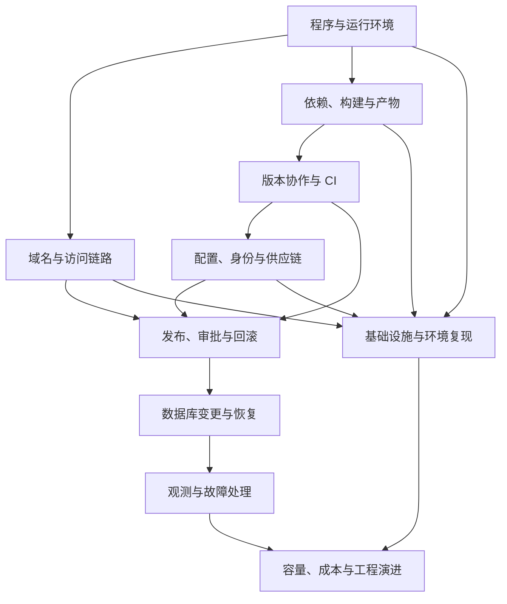

# 部署与工程：学习框架与内容计划

调研与首版整理：2026-10-23。面向已能做出简单本地网页或接口、希望理解线上交付的读者。

这是一张逐步实践的地图，不代表作者或读者已经掌握全部知识，也不把某一种云平台方案当作通用答案。公开入口为 `/learn/engineering`；首篇实战是 `/learn/engineering/firstform-cicd`。其余节点保留“规划中”，不生成可阅读链接。

## 2026-10-23 阅读反馈与当前工作顺序

用户阅读 CI/CD 案例初稿后，指出以下问题。页面目前保留为占位草稿，这些问题尚未解决，不能将工程检查通过视为教学效果或设计已经获得认可。

| 待改进问题 | 用户反馈与后续目标 |
| --- | --- |
| 内容组织与阅读逻辑 | 内容混乱，缺少能跟随的理解顺序，读者看不懂。后续依据实际教学中验证有效的因果链重组文章，先明确问题和前置概念，再逐步解释。 |
| 外观与信息表达 | 样式粗糙，层次和图文表达缺乏审美。后续统一梳理版式、图解和阅读节奏，不以堆叠卡片代替信息设计。 |
| 项目调性与完成度 | 基础组件和图标的组合显得生硬、初级，未体现初构期待的设计水准。现有呈现不是已确认的最终方向，后续整体打磨。 |

本次只记录反馈，不修改页面内容、布局、样式或图标。当前重心回到用户本人对 CI/CD 技术的理解，视觉与对外文章表达留待后续集中修改。

后续按以下顺序协作：

1. **先教会用户。**以老师和技术专家的方式，用专业、准确、简单直接的语言解释；一次围绕一个核心问题，说明它解决什么、为什么需要、在本项目里怎样发生。陌生术语先解释，再使用。
2. **通过讨论核对理解。**让用户用自己的话解释因果，或预测一个条件改变后的结果；发现缺口就补前置知识与具体例子。不能把已经运行成功、读过文章或一次点头当作理解到位。
3. **再整理已经理解的内容。**用户理解并讨论清楚后，共同提炼讲解顺序、例子、边界与规律，再补入文章，向现有 PR 逐次提交有明确内容的小改动。不能用直接扩写页面代替教学。
4. **最后统一打磨呈现。**内容稳定后，再整体改善阅读组织、图文叙事、布局、组件和视觉语言；届时重新验收教学效果与外观。

学习地图用于确定方向，不要求一口气学习所有主干。当前从 CI/CD 本身出发，具体节奏依据用户的问题和理解推进。生产发布继续遵循既有门禁，内容初稿不自动视为已获发布认可。

## 框架怎样组织

围绕一次变更的生命周期组织问题：程序如何运行 → 用户如何访问 → 输出如何被构建 → 改动如何被验证 → 谁可以发布 → 发布如何恢复 → 数据如何演进 → 故障如何被发现 → 环境如何复现 → 何时值得扩展。

安全、测试、版本管理和文档贯穿全程，单独列成主干是为了集中学习，并不表示到那个阶段才开始考虑。后端业务协议和数据库建模由相邻领域展开，这里关注运行、交付与维护边界。

这是为初构设计的推荐路径，不是外部来源给出的唯一课程。可以先从已完成的 CI/CD 案例看到全貌，再回到基础逐个补齐。前八个主干构成小型网站也需要理解的交付与运维闭环；主机、容器、编排、平台工程按实际需要逐步深入。使用托管平台会转移部分维护工作，但仍要理解配置、数据、权限、可观测性和恢复责任。

## 主干与学习顺序

| 阶段 | 主干 | 要回答的问题 | 实验与验收 |
| --- | --- | --- | --- |
| 看懂运行 | 程序与运行环境 | 静态文件、进程、运行时、端口和配置分别是什么？ | 启停本地服务、改变端口和变量；能画出代码与数据所在的位置。 |
| 看懂运行 | 域名与访问链路 | DNS、TLS、HTTP、代理与缓存怎样配合？ | 沿一次请求排查域名、连接、响应与缓存；能解释本地可用而公网失败的排查顺序。 |
| 看懂运行 | 依赖、构建与产物 | 怎样重建、标识和保存确定的输出？ | 从干净目录按锁文件构建；解释源码、缓存和产物的区别。 |
| 建立交付 | 版本协作与 CI | 怎样尽早发现冲突与回归，什么结果必须阻止合并？ | 故意制造失败 PR，再修复；能为一个风险选合适的测试层次。 |
| 建立交付 | 配置、身份与供应链 | 谁获得哪些权限，什么时候获得，如何失效？ | 画身份与凭据流向；解释 Secret、Token、OIDC、来源证明和审计的作用。 |
| 建立交付 | 发布、审批与回滚 | 什么版本可以发布，如何确认与恢复？ | 走完小变更闭环；从线上追溯提交、检查、产物和批准。 |
| 守住线上 | 数据库变更与恢复 | 新旧代码如何兼容已有数据？ | 隔离环境升级旧结构和测试数据，再恢复备份；解释 RPO / RTO。 |
| 守住线上 | 观测与故障处理 | 怎样知道用户受影响，又怎样快速恢复？ | 制造测试环境故障，用日志定位；定义一个 SLO，写可行动的告警与手册。 |
| 按需扩展 | 基础设施与环境复现 | 谁维护主机，容器与 IaC 各解决什么？ | 本地容器网络与卷实验，阅读资源变更计划；能说明何时需要编排。 |
| 按需扩展 | 容量、成本与工程演进 | 瓶颈是什么，扩展是否值得？ | 有限负载实验；用延迟、错误、资源与成本解释一个改进决策。 |

节点、前置主干、实验、理解标准和参考资料统一维护在 `src/learning/engineering.ts`。页面的学习路线与知识树消费同一份数据，避免两套大纲漂移。节点描述保留进一步写课时的问题边界；树的展示继续保持简洁。

## 调研依据

只选原作者、官方文档与研究项目，不把第三方工具清单直接当课程。以下资料分别支持不同层次；学习顺序和练习是本项目的综合设计。

| 资料 | 用于建立的框架 |
| --- | --- |
| [MDN：Web 服务器](https://developer.mozilla.org/en-US/docs/Learn_web_development/Howto/Web_mechanics/What_is_a_web_server)、[HTTP 缓存](https://developer.mozilla.org/en-US/docs/Web/HTTP/Guides/Caching) | 静态与动态内容、请求与响应、访问和缓存边界。 |
| [Cloudflare：Workers 如何运行](https://developers.cloudflare.com/workers/reference/how-workers-works/) | 托管运行时与应用代码的职责；与当前项目对应。 |
| [DORA：持续集成](https://dora.dev/capabilities/continuous-integration/)、[测试自动化](https://dora.dev/capabilities/test-automation/)、[持续交付](https://dora.dev/capabilities/continuous-delivery/) | 小批量集成、快速反馈、自动化测试、可交付状态；CI 不只是一份 YAML。 |
| [GitHub：Rulesets](https://docs.github.com/en/repositories/configuring-branches-and-merges-in-your-repository/managing-rulesets/about-rulesets)、[部署环境](https://docs.github.com/en/actions/how-tos/deploy/configure-and-manage-deployments/manage-environments) | 区分仓库规则、工作流依赖、环境审批和凭据边界。 |
| [Google SRE：发布工程](https://sre.google/sre-book/release-engineering/) | 构建、版本、发布与可追踪性。 |
| [DORA：数据库变更](https://dora.dev/capabilities/database-change-management/)、[D1 命令](https://developers.cloudflare.com/d1/wrangler-commands/) | 数据变更纳入交付设计；明确本地迁移与远程操作。 |
| [OpenTelemetry：可观测性](https://opentelemetry.io/docs/concepts/observability-primer/)、[Google SRE：服务目标](https://sre.google/sre-book/service-level-objectives/) | 从用户体验定义目标，用日志、指标和调用链定位问题。 |
| [Docker 概述](https://docs.docker.com/get-started/docker-overview/)、[Terraform 概述](https://developer.hashicorp.com/terraform/intro)、[Kubernetes 概述](https://kubernetes.io/docs/concepts/overview/) | 区分运行隔离、基础设施生命周期和集群能力；它们不自动替代 CI/CD。 |
| [SLSA 规范](https://slsa.dev/spec/v1.2/) | 供应链威胁与构建来源；普通文件哈希不能被描述为完整来源证明。 |
| [Google SRE：应对过载](https://sre.google/sre-book/handling-overload/) | 容量、过载、保护与恢复需要实测和取舍。 |

页面中的资料入口按主干关联，读者可从待写主题继续查阅官方材料。平台文档会更新；新增课程时需要重新核对涉及的命令、限制和产品行为。

## 首篇案例的事实边界

案例绑定真实发布提交 `4f58baf92782e85ab607bd2045cbf384a73590ba`，对应 [成功运行](https://github.com/jamesonics/firstform-lab/actions/runs/39929665964) 与标签 `firstform-cicd-v1-20261023`。仓库规则与生产环境配置按 2026-10-23 核对记录说明，不把历史快照标为实时状态。

- PR 与 main 分别检查；合并门禁和生产门禁是不同约束。
- CI 的 D1 在 Runner 本地，PostgreSQL 是临时容器；Go 研究代码不作为当前线上后端发布。
- 人工批准后下载同一次运行的产物，核对提交、文件列表和摘要，再上传。
- 生产发布使用 GitHub 环境 Secret 中的 Cloudflare API Token；过去本机 Wrangler OAuth 不被复制到 PR 检查。
- 健康检查只验证基础可用性，失败不会自动回滚。生产数据库迁移另行设计、备份和执行。
- 单人项目未强制第二人审查；GitHub 规则不撤销云平台独立权限。
- 教学模拟只计算浏览器内的状态，假设配置、鉴权与上传命令正常，不能用于真实发布判定。

## 怎样逐步把理解变成作品

每个节点沿同一条路径补齐：真实问题 → 前置知识 → 解释原理 → 提出可验证预测 → 隔离实验 → 对照结果 → 说明适用边界 → 形成文章或交互作品。

发布节点前，读者应能不用照抄讲出主要因果，独立完成一个实验，指出至少一个失效条件。页面自检不写入“已掌握”状态；内容发布与个人掌握程度分别判断。以后可以增加学习记录，但不能以浏览或打勾代替理解。

每次新增文章才注册路由并为对应节点设置 `articleId`。按既有 PR → CI → main CI → 人工批准 → 线上验收流程发布；知识树可以先公开结构，后续文章逐步加入。
